

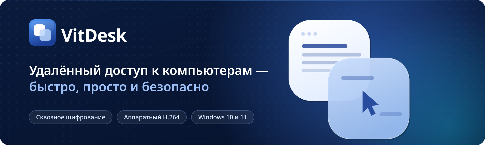

  

&nbsp;&nbsp;

  

 

> [!NOTE]
> **VitDesk** соединяет ваше устройство с тем, к которому нужно подключиться: вы видите экран, управляете мышью и клавиатурой, передаёте файлы — как будто сидите рядом. Ни белого IP, ни настройки роутера не нужно.

 

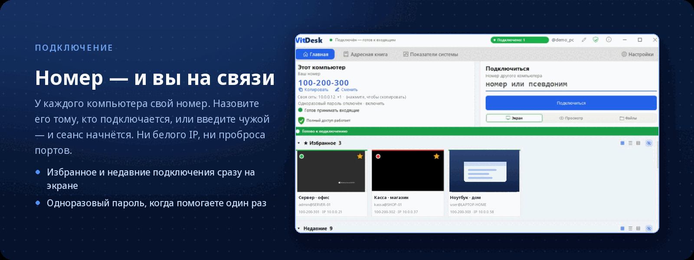

 

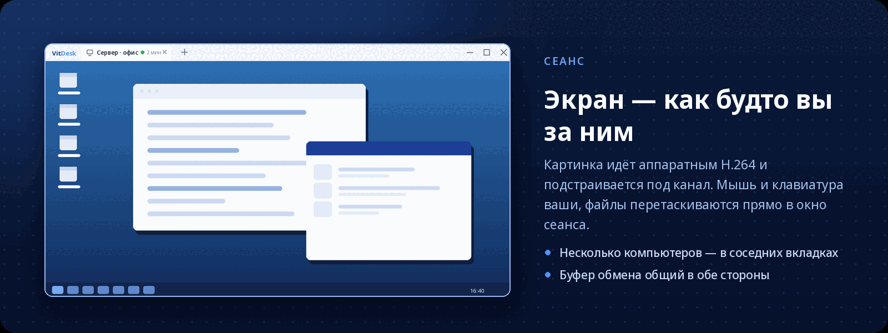

 

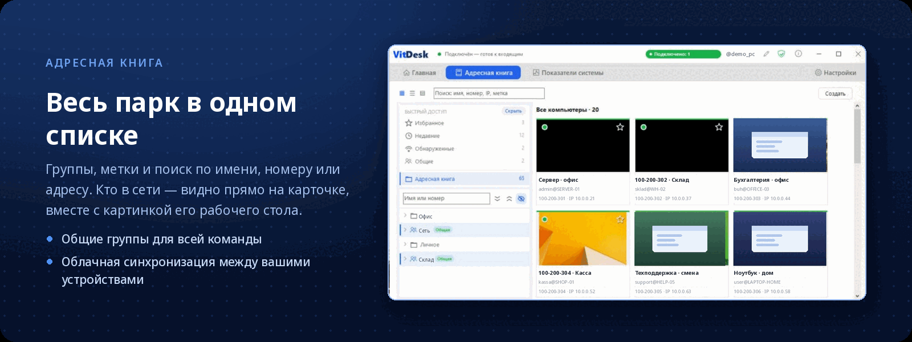

 

 

## Что ещё умеет

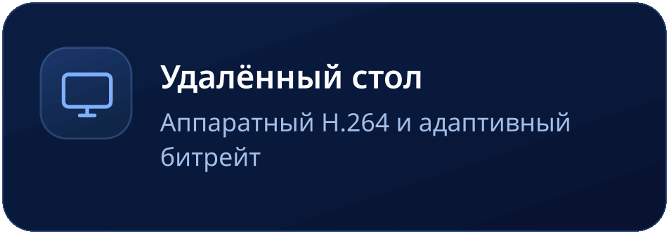
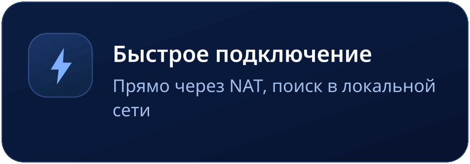
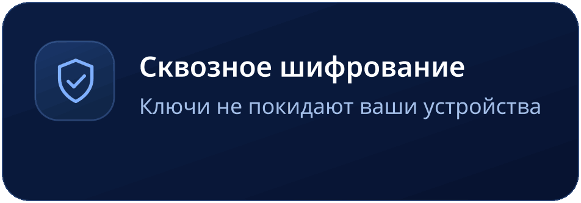
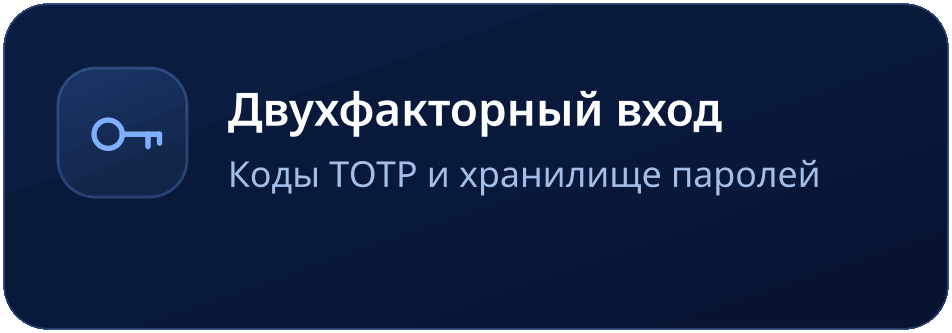
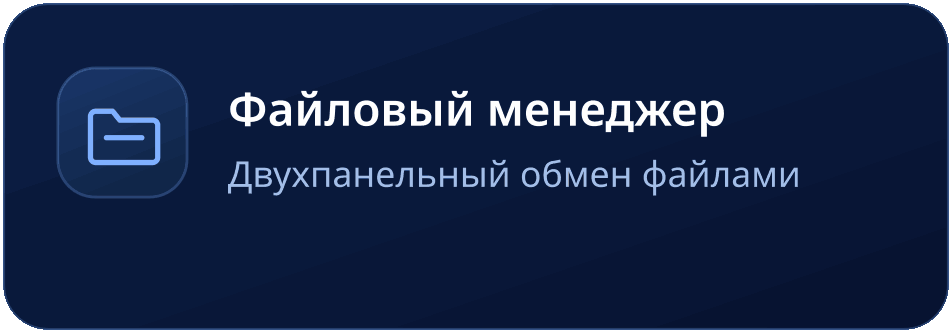
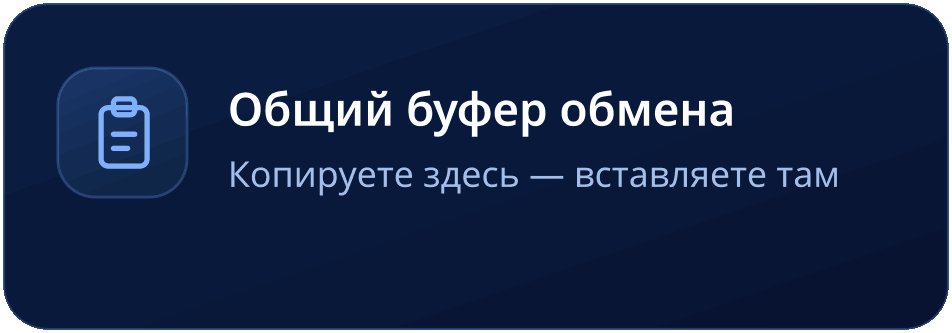
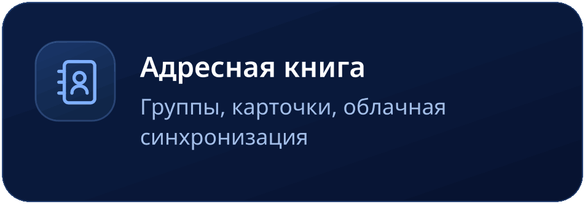

 

## Как это работает

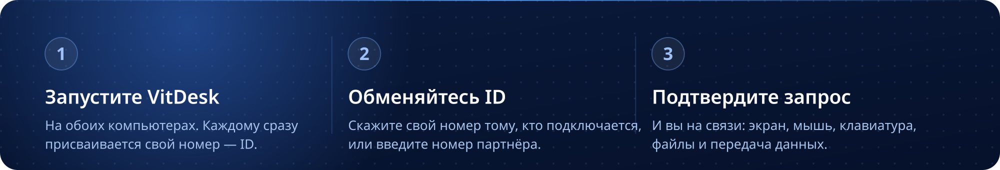

> [!TIP]
> Для постоянного доступа без подтверждения задайте пароль — и подключайтесь к своему компьютеру из любой точки мира.

 

## Установка

1. Нажмите **«Скачать для Windows»** — начнётся загрузка `VitDesk.exe`.
2. Запустите файл и следуйте шагам мастера установки.
3. Программа сразу покажет ваш **ID** — его и сообщают тому, кто подключается.

 

## Кому подходит

 

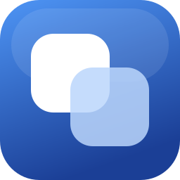

© ZVytautasR · VitDesk · Автор и разработчик — Витаутас Жаситис

