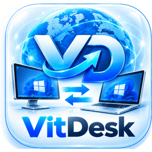

# VitDesk

**Быстрый и безопасный удалённый доступ к вашим компьютерам — с Windows и Android**

 

<!-- Кнопка, оформленная через таблицу (GitHub её не вырезает) -->
<table align="center" border="0" cellpadding="15" cellspacing="0" style="background-color: #28a745; border-radius: 12px; box-shadow: 0 4px 10px rgba(0,0,0,0.2);">
  <tr>
    <td align="center">
      <a href="Спасибо.md" style="color: white; text-decoration: none; font-size: 20px; font-weight: bold;">
        📥 Скачать VitDesk
      </a>
    </td>
  </tr>
</table>

 

[✨ Возможности](#-возможности) • [🚀 Как это работает](#-как-это-работает)

---

## 💡 Что такое VitDesk

VitDesk соединяет ваше текущее устройство с тем, к которому нужно подключиться: видите экран, управляете мышью и клавиатурой, передаёте файлы и общаетесь — как будто сидите рядом.

## ✨ Возможности

| | Возможность | Описание |
|---|---|---|
| 🖥️ | **Удалённый рабочий стол** | Плавная картинка с аппаратным кодированием H.264 и адаптивным битрейтом |
| ⚡ | **Быстрое подключение** | Соединение напрямую через NAT, поиск устройств в локальной сети |
| 🔒 | **Безопасность** | Сквозное шифрование, TOTP‑двухфакторка, хранилище паролей |
| 📁 | **Файловый менеджер** | Двухпанельный обмен файлами между компьютерами |
| 📋 | **Общий буфер обмена** | Копируйте на одном устройстве — вставляйте на другом |
| 💬 | **Чат и видеозвонки** | Текст, звук (Opus) и камера прямо в сессии |
| 🖨️ | **Удалённая печать** | Печать с удалённого компьютера на локальный принтер |
| 🔌 | **USB по сети** | Проброс USB‑устройств на удалённую машину |
| 🎥 | **Запись сессий** | Сохраняйте сеансы для отчётов и обучения |
| 📒 | **Адресная книга** | Группы, карточки устройств, облачная синхронизация |
| 🌙 | **Wake‑on‑LAN** | Разбудите спящий компьютер одним кликом |
| 🛎️ | **Служба поддержки** | Режим ServiceDesk для работы с обращениями |

## 📥 Установка

<!-- Кнопка установки -->
<table align="center" border="0" cellpadding="12" cellspacing="0" style="background-color: #218838; border-radius: 10px;">
  <tr>
    <td align="center">
      <a href="Спасибо.md" style="color: white; text-decoration: none; font-size: 18px; font-weight: bold;">
        📥 Перейти к скачиванию
      </a>
    </td>
  </tr>
</table>

  <b>Благодарим вас за загрузку!</b> 
  Нажмите на кнопку выше, чтобы перейти на страницу скачивания файла <code>VitDesk.exe</code>.

1. Нажмите кнопку выше.
2. На открывшейся странице нажмите «Скачать», чтобы получить файл `VitDesk.exe`.
3. Запустите файл и следуйте инструкциям мастера установки.

> [!TIP]
> Чтобы подключиться, сообщите партнёру свой **ID** — и примите входящий запрос.

## 🚀 Как это работает

Всё просто: установка и настройка сети не нужны.

1. **Запустите VitDesk** на обоих устройствах — каждому сразу присваивается свой **ID**.
2. **Сообщите ID** тому, кто будет подключаться (или введите ID партнёра сами).
3. **Подтвердите входящий запрос** — и вы на связи: экран, мышь, клавиатура, файлы и чат.

> [!NOTE]
> Для постоянного доступа без подтверждения задайте пароль — и подключайтесь к своему компьютеру из любой точки мира.

### 🎯 Для чего подходит

- 🧑‍💻 **Помощь близким и коллегам** — разберитесь с проблемой, не выходя из дома
- 🏢 **Техподдержка и IT‑администрирование** — обслуживайте парк компьютеров
- 🏠 **Доступ к своему ПК** — с ноутбука или телефона, где бы вы ни были
- 📱 **Управление с Android** — компьютер всегда в кармане

© ZVytautasR • VitDesk

