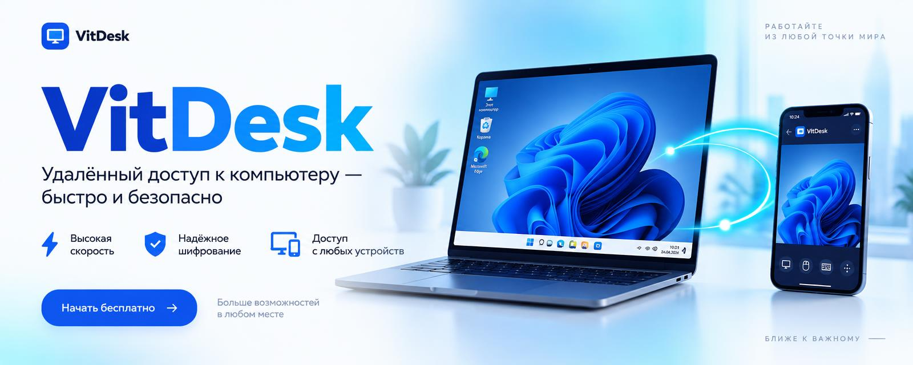

 

# VitDesk

### Быстрый и безопасный удалённый доступ к вашим компьютерам — с Windows и Android

 

  

  

**[✨ Возможности](#-возможности)** &nbsp;·&nbsp; **[🚀 Как это работает](#-как-это-работает)** &nbsp;·&nbsp; **[📥 Установка](#-установка)** &nbsp;·&nbsp; **[🎯 Для чего](#-для-чего-подходит)**

 

> [!NOTE]
> **VitDesk** соединяет ваше устройство с тем, к которому нужно подключиться: видите экран, управляете мышью и клавиатурой, передаёте файлы и общаетесь — как будто сидите рядом.

 

## ✨ Возможности

<table>
<tr>
<td width="33%" valign="top">

### 🖥️ Удалённый стол
Плавная картинка с аппаратным кодированием H.264 и адаптивным битрейтом

</td>
<td width="33%" valign="top">

### ⚡ Быстрое подключение
Соединение напрямую через NAT, поиск устройств в локальной сети

</td>
<td width="33%" valign="top">

### 🔒 Безопасность
Сквозное шифрование, TOTP‑двухфакторка, хранилище паролей

</td>
</tr>
<tr>
<td valign="top">

### 📁 Файловый менеджер
Двухпанельный обмен файлами между компьютерами

</td>
<td valign="top">

### 📋 Общий буфер
Копируйте на одном устройстве — вставляйте на другом

</td>
<td valign="top">

### 💬 Чат и видеозвонки
Текст, звук (Opus) и камера прямо в сессии

</td>
</tr>
<tr>
<td valign="top">

### 🖨️ Удалённая печать
Печать с удалённого компьютера на локальный принтер

</td>
<td valign="top">

### 🔌 USB по сети
Проброс USB‑устройств на удалённую машину

</td>
<td valign="top">

### 🎥 Запись сессий
Сохраняйте сеансы для отчётов и обучения

</td>
</tr>
<tr>
<td valign="top">

### 📒 Адресная книга
Группы, карточки устройств, облачная синхронизация

</td>
<td valign="top">

### 🌙 Wake‑on‑LAN
Разбудите спящий компьютер одним кликом

</td>
<td valign="top">

### 🛎️ Служба поддержки
Режим ServiceDesk для работы с обращениями

</td>
</tr>
</table>

 

## 🚀 Как это работает

Установка сложной сети не нужна — три шага:

<table>
<tr>
<td width="33%" align="center" valign="top">

<h1>1️⃣</h1>

**Запустите VitDesk** 
на обоих устройствах — каждому сразу присваивается свой **ID**

</td>
<td width="33%" align="center" valign="top">

<h1>2️⃣</h1>

**Сообщите ID** 
тому, кто будет подключаться, или введите ID партнёра сами

</td>
<td width="33%" align="center" valign="top">

<h1>3️⃣</h1>

**Подтвердите запрос** 
и вы на связи: экран, мышь, клавиатура, файлы и чат

</td>
</tr>
</table>

> [!TIP]
> Для постоянного доступа без подтверждения задайте пароль — и подключайтесь к своему компьютеру из любой точки мира.

 

## 📥 Установка

1. Нажмите кнопку **«Скачать»** ниже.
2. Дождитесь скачивания файла `VitDesk.exe`.
3. Запустите файл и следуйте инструкциям мастера установки.

 

## 🎯 Для чего подходит

| | |
|:---:|---|
| 🧑‍💻 | **Помощь близким и коллегам** — разберитесь с проблемой, не выходя из дома |
| 🏢 | **Техподдержка и IT‑администрирование** — обслуживайте парк компьютеров |
| 🏠 | **Доступ к своему ПК** — с ноутбука или телефона, где бы вы ни были |
| 📱 | **Управление с Android** — компьютер всегда в кармане |

 

Сделано с 💙 · © ZVytautasR · VitDesk

