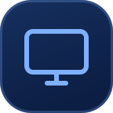
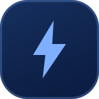
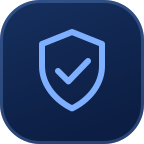
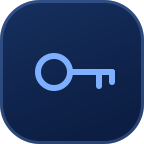
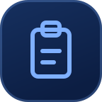
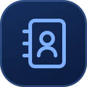

  

&nbsp;&nbsp;

  

 

> [!NOTE]
> **VitDesk** соединяет ваше устройство с тем, к которому нужно подключиться: вы видите экран, управляете мышью и клавиатурой, передаёте файлы — как будто сидите рядом. Ни белого IP, ни настройки роутера не нужно.

 

## Возможности

<table>
<tr>
<td width="33%" align="center"> <b>Удалённый стол</b> Аппаратный H.264 и адаптивный битрейт под вашу сеть</td>
<td width="33%" align="center"> <b>Быстрое подключение</b> Прямое соединение через NAT и поиск в локальной сети</td>
<td width="33%" align="center"> <b>Сквозное шифрование</b> Данные видны только вам, ключи не покидают устройства</td>
</tr>
<tr>
<td align="center"> <b>Двухфакторный вход</b> Коды TOTP и собственное хранилище паролей</td>
<td align="center"> <b>Файловый менеджер</b> Двухпанельный обмен файлами между компьютерами</td>
<td align="center"> <b>Общий буфер обмена</b> Копируете на одном — вставляете на другом</td>
</tr>
<tr>
</tr>
<tr>
<td align="center"> <b>Адресная книга</b> Группы, карточки устройств, облачная синхронизация</td>
</tr>
</table>

 

## Как это работает

> [!TIP]
> Для постоянного доступа без подтверждения задайте пароль — и подключайтесь к своему компьютеру из любой точки мира.

 

## Установка

1. Нажмите **«Скачать для Windows»** — начнётся загрузка `VitDesk.exe`.
2. Запустите файл и следуйте шагам мастера установки.
3. Программа сразу покажет ваш **ID** — его и сообщают тому, кто подключается.

 

## Кому подходит

<table>
<tr>
<td width="50%"><b>Помощь близким и коллегам</b> Разберитесь с проблемой, не выходя из дома</td>
<td width="50%"><b>Техподдержка и IT‑администрирование</b> Обслуживайте парк компьютеров из одного места</td>
</tr>
<tr>
<td><b>Доступ к своему ПК</b> Рабочий стол под рукой, где бы вы ни были</td>
<td><b>Круглосуточный доступ</b> Задайте пароль — и подтверждение не потребуется</td>
</tr>
</table>

 

© ZVytautasR · VitDesk · Автор и разработчик — Витаутас Жаситис

